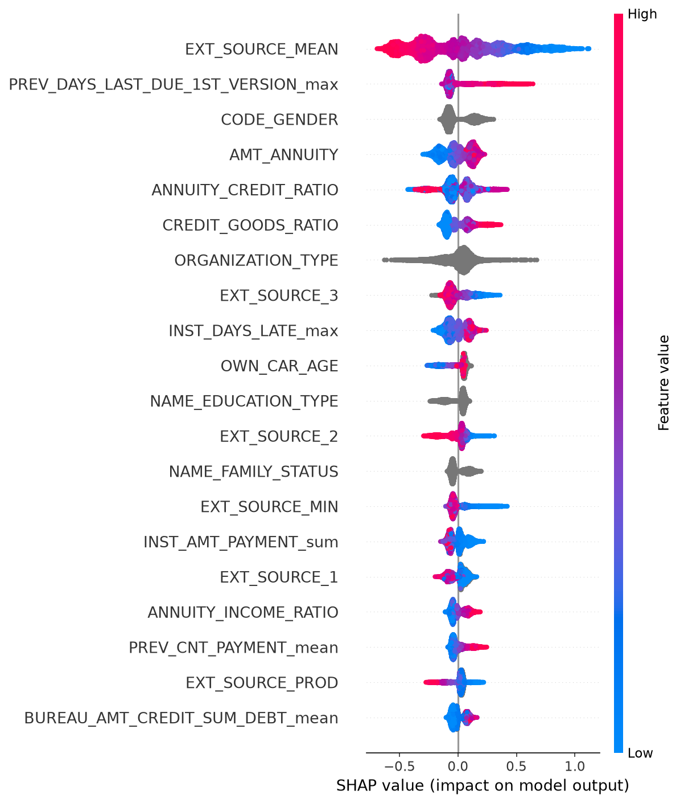
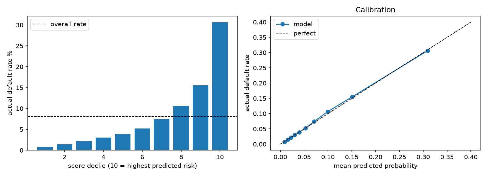

# Home Credit Default Risk

Predict which loan applicants will have payment difficulties (`TARGET = 1`), using the [Home Credit Default Risk](https://www.kaggle.com/competitions/home-credit-default-risk) data. About 8% of the 307,511 applicants are positives, so the metric is **ROC-AUC** and all splits are stratified.

## Result

Cross-validated ROC-AUC, built up one step at a time (each step must beat the previous one):

| Step | AUC | Notebook |
|---|---|---|
| Cleaned baseline (application table, LightGBM) | 0.7581 | 02, 03 |
| + engineered features (ratios, years, combined external scores) | 0.7650 | 03 |
| + aggregated bureau, previous application and installments tables | 0.7868 | 04 |
| + tuning with Optuna and early stopping (fresh 5-fold split) | **0.7914** | 06 |

Hold-out AUC of the tuned model (80/20 split): 0.7918.

**Final locked test set (notebook 11): AUC 0.7922** (95% bootstrap interval 0.786 to 0.798). 20% of applicants were set aside first and scored once, after every choice had been made on the other 80%. The LightGBM settings were originally tuned on all rows, so a strictly clean figure could be slightly lower.

Fold-to-fold spread is about 0.003 to 0.004, so differences smaller than that are noise. In particular, the Optuna search itself added only +0.0021 over the old settings with early stopping; most of the tuning gain came from more trees at a lower learning rate.

### Default-settings comparison (quick look, notebook 10)
One 80/20 split, library defaults, no cross-validation, no tuning, so no error bars (the usual fold spread is about 0.003 to 0.004 AUC).

| Model | Train AUC | Test AUC |
|---|---|---|
| LightGBM | 0.839 | 0.784 |
| Logistic regression | 0.778 | 0.774 |
| XGBoost | 0.912 | 0.773 |
| Random forest | 1.000 | 0.732 |
| Dummy (base rate) | 0.500 | 0.500 |

Default random forest and XGBoost overfit strongly (large train-test gap); they are not tuned or cross-validated here, so this is a first look and not a ranking. Tuned, cross-validated results exist only for LightGBM (0.7914).

### What did not help (and is reported as such)
- POS-cash and credit-card tables: 0.7882 with all five tables vs 0.7868 with three, within noise, so they were left out.
- Ideas from the error analysis (notebook 11, 3-fold CV): ten extra external-score features changed AUC by -0.0003, and recent (365-day) payment behaviour by +0.0007, both far below the fold spread (about 0.0045). Blending LightGBM with XGBoost added 0.0006, under the 0.001 threshold set in advance. None were kept, so the locked-test score equals the baseline's.
- One-hot encoding and log transforms: no change for LightGBM (0.7868 vs 0.7867). They helped logistic regression (0.7649 to 0.7737 AUC), which stays below LightGBM.

## What drives the predictions (SHAP, notebook 07)



- The combined external score (`EXT_SOURCE_MEAN`) is by far the strongest feature; low scores push towards default.
- Share of total SHAP importance by source: application 48%, previous applications 25%, bureau 14%, instalments 14%.
- Directions agree with the EDA: larger loan annuity, a loan larger than the goods price, and late instalments raise predicted risk.

## Where the model goes wrong (error analysis, notebook 09)



- Ranking and calibration are good: the default rate rises from 0.8% in the lowest-scored tenth of applicants to 30.6% in the highest, and predicted probabilities match actual rates.
- Flagging the riskiest 20% catches 57% of defaulters (23% of flagged applicants default). The missed defaulters look like good applicants: their external scores are close to those of people correctly cleared.
- Ranking is weakest inside some groups (ages 60 to 70, AUC 0.752; pensioner-like applicants, 0.766; ages 20 to 30, 0.767). Small groups are noisy and no confidence intervals were computed.

## Approach

1. **EDA** (`notebooks/01_eda.ipynb`): target balance, missing values, anomalies, default rate by category, correlations.
2. **Decisions** ([DECISIONS.md](DECISIONS.md)): every cleaning and feature choice is logged with the evidence behind it, for example the `DAYS_EMPLOYED = 365243` placeholder (18% of rows, mostly pensioners) and `XNA` labels.
3. **Features** (`src/features.py`): cleaning, ratios, combined external scores, rare-category merging.
4. **Relational tables** (`src/aggregate.py`): each secondary table is reduced to one row per applicant (mean, max, min, sum, category shares, count).
5. **Modelling and tuning**: LightGBM with native categories and missing values; Optuna search (30 trials) re-scored on a different split to avoid an optimistic estimate.
6. **Explanation**: SHAP on 10,000 held-out applicants.

The general checklist for approaching a new dataset is in [APPROACH.md](APPROACH.md); column meanings are in [data_dictionary.md](data_dictionary.md).

## Limitations and next steps

- **Only one model family was tuned.** Logistic regression was run only as an untuned benchmark. Comparing more algorithms (for example random forest, XGBoost or CatBoost) with cross-validation and tuning is the main open item.
- **Sensitive attributes.** Age and gender are used by the model (default rate falls from 11.5% for ages 20 to 30 to 4.9% for ages 60 to 70; `CODE_GENDER` is the third most important feature). This is acceptable for a learning project but would need a fairness and legal review before real lending use.
- No Kaggle test set was available from the mirror dataset, so all scores are cross-validation or hold-out estimates on the training data.
- Scores are well calibrated (notebook 09), but no real approval threshold or cost analysis was done: the 5:1 cost ratio used there is an illustrative assumption, not a Home Credit figure.

## Reproduce

```bash
uv sync
```

Download the data into `data/raw/` (files are prefixed `HC_`; the folder is gitignored and needs Kaggle credentials, never commit a token), then:

```bash
uv run python src/aggregate.py bureau previous installments
```

and run the notebooks in order. Tuned parameters are written to `models/best_params.json`.

## Repository layout

| Path | Contents |
|---|---|
| `notebooks/` | 01 EDA, 02 baseline, 03 features, 04 tables, 05 encoding and log, 06 tuning, 07 SHAP, 08 tuned model comparison (not executed: it exceeded this laptop's memory), 09 error analysis, 10 default-settings comparison, 11 feature improvements with a locked test set |
| `src/` | `features.py`, `aggregate.py` |
| `DECISIONS.md`, `APPROACH.md`, `data_dictionary.md` | Decision log, method checklist, column guide |
| `assets/` | Figures used in this README |
| `course/` | Course brief and template material (not part of the analysis) |
